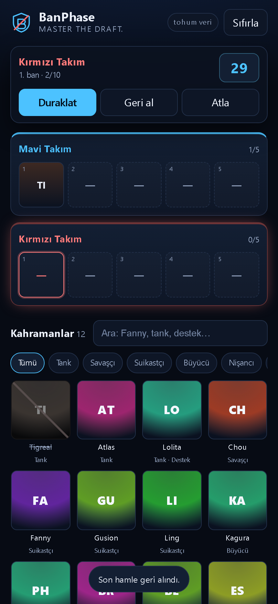
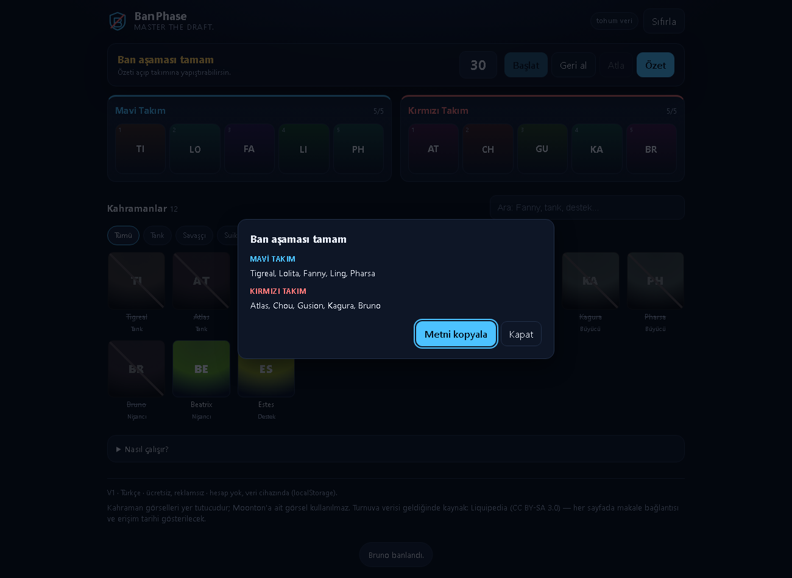

# BanPhase

**Master the Draft.** — Mobil öncelikli, ücretsiz, reklamsız ban aşaması yardımcısı.
V1 Türkçe. Hesap yok, sunucu yok, veri cihazda.

**Canlı:** <https://metenyu.github.io/BanPhase/>

## Durum

Faz 3 tamam: çalışan ban tahtası + **133 kahramanlık gerçek kimlik listesi**.
Turnuva verisi **henüz yok** (Liquipedia başvurusu bekliyor); uygulama istatistik,
build veya sıralama iddia etmiyor — yalnızca kimlik (ad, rol).



## Doğrulama (24.10.2026)

Edge headless + CDP ile gerçek tarayıcıda koşuldu:

- 133 kahraman, 20 slot (10 ban + 10 seçim), 390 px ve 1300 px'te yatay taşma yok
- **Turnuva sırası** ölçüldü: `ban M×3, K×3 → seçim M×3, K×3 → ban K×2, M×2 → seçim K×2, M×2`
- **Ranked sırası**: 5+5 ban aynı anda, sonra `seçim M,K,K,M,M,K,K,M,M,K`
- Ranked'da herhangi bir boş ban slotu seçilip doldurulabiliyor; geri alınca slot boşalıp yeniden aktif oluyor
- 20 hamlede tahta doluyor, özet diyaloğu ban + seçim satırlarını gösteriyor
- **Kompozisyon analizi** takım bazında: "Mavi: Tank 2 · Savaşçı 1 · Suikastçı 1 · Destek 1 /
  Nişancı yok" — iki takımın seçimleri karışmıyor
- Draft kaydı iki takımın compunu birlikte saklıyor, yenilemede duruyor, silinebiliyor
- Formattaki kullanılmış kahramanlar listede kilitleniyor (20/133)
- konsol hatası ya da yakalanmamış istisna yok
- service worker `banphase-v4` kayıtlı; ağ kapalıyken sayfa açılıyor



## Ne yapar (V1)

- **Turnuva** formatı: 3+3 ban → 3+3 seçim → 2+2 ban → 2+2 seçim (fazları sırayla
  diğer takım başlatır)
- **Ranked** formatı: 10 ban aynı anda (serbest sıra) → 1-2-2-2-2-1 seçim
- İlk seçim hakkı Mavi/Kırmızı seçilebilir; format ve seçim `localStorage`'da kalıcı
- 30 saniyelik sıra süresi (turnuvada; ranked ban fazında sayaç yok)
- 133 kahraman içinde arama + rol filtresi (Türkçe karakter duyarsız)
- Geri al, tahtayı sıfırla, özeti panoya kopyala
- **Draft sonrası kompozisyon analizi:** her takım için ana rol dağılımı + eksik rol uyarıları
- **Kayıtlı draftlar:** iki takımın compunu birlikte kaydet, galeride tut (cihazda)
- PWA: çevrimdışı açılır, ana ekrana eklenebilir

## Çalıştırma

Statik dosyalar; ama `fetch()` ve service worker için sunucu gerekir.

```powershell
npx --yes serve . -l 4321     # sonra: http://localhost:4321
```

Kahraman listesini yeniden üretmek için (kaynak dosya değiştiyse):

```powershell
node tools/build-heroes.mjs
```

## Yapı

```
index.html                     tek sayfa
assets/css/style.css           tema + yerleşim
assets/js/app.js               durum, ban mantığı, zamanlayıcı
data/heroes.json               üretilen kimlik listesi (133 kahraman)
data/source/                   ham kaynak (Fandom + Rone eşlemesi)
tools/build-heroes.mjs         kaynaktan data/heroes.json üretir
manifest.webmanifest           PWA tanımı
sw.js                          kabuk önbelleği
icons/                         yer tutucu ikon (svg + 192/512 png)
docs/                          kararlar, Faz 2 denetimi, Liquipedia başvurusu
```

## Veri politikası

1. **Rone istatistik ve build'leri V1'de kullanılmaz.** Verisi Eylül 2025 damgalı
   (`2.1.18`) ve oyun verisi üzerindeki hak belirsiz. Arşiv yalnızca araştırma
   içindir, yayımlanmaz. Ayrıntı: `docs/FAZ2-RAPORU.md`.
2. **Kahraman kimliği** Fandom MLBB Wiki'den (CC BY-SA 3.0) alınır; `roneId`
   yalnızca eşleme içindir. Yayımlanan dosya id + ad + rol içerir; istatistik yok.
3. **Turnuva verisi Liquipedia'dan** gelecek, onay sonrası, günde en fazla bir kez
   çekilip depoda JSON olarak yayımlanacak (statik uygulamanın başka veri kaynağı yok).
4. **Ham veri dökümü yayımlanmaz**; yalnızca türetilmiş özet istatistik.
5. Her turnuva görünümünde makale bağlantısı + erişim tarihi bulunur.
6. Moonton'a ait görsel kullanılmaz; kahraman görselleri renk + baş harf yer tutucusudur.

## Lisans

| Kapsam | Lisans |
|---|---|
| Kod (`index.html`, `assets/`, `sw.js`, `tools/`) | MIT — bkz. `LICENSE` |
| `data/heroes.json`, `data/source/` | CC BY-SA 3.0 — atıf: [Fandom MLBB Wiki](https://mobile-legends.fandom.com/) |
| `data/liquipedia/` (gelecek) | CC BY-SA 3.0 — atıf: Liquipedia |

Veriyi JS paketine gömmeyin; ayrı JSON kalsın ki lisanslar ayrışsın.

## Yayın

`main`'e push otomatik yayına girer (Pages → Deploy from a branch, `/ (root)`).
Tarayıcı tarafında dosya güncellediyseniz **`sw.js` içindeki `VERSION` değerini
artırın**, aksi hâlde dönen ziyaretçi eski dosyayı önbellekten alır.

## Sıradaki adımlar

- [ ] Liquipedia başvurusu (`docs/LIQUIPEDIA-BASVURU.md`, tek eksik: iletişim adresi)
- [ ] Turnuva/ban istatistiği ekranı (Liquipedia onayı sonrası)
- [ ] Erişilebilirlik turu (ekran okuyucu, klavye ile tam gezinme)
- [ ] Özet metnine turnuva adı / maç bilgisi ekleme

## Bilinen sınırlar

- **Comp analizi şimdilik yalnızca rol bazlı.** Koridor (gold/exp/mid/jungle/roam),
  oyun stili (engage/poke/split), hasar tipi ve güç eğrisi etiketleri yok — bunlar
  `docs/CUE-GOREVLERI.md` ile Cue'dan isteniyor.
- "A comp'u B comp'u yener" iddiası **yok**; bunun için turnuva maç verisi gerekiyor
  (Liquipedia onayı).

- **Faz başlangıçları kullanıcı bilgisine dayanıyor:** turnuvada her fazı sırayla
  diğer takım başlatıyor (ban1 mavi → seçim1 mavi → ban2 kırmızı → seçim2 kırmızı).
  "Eşit başlanır" ifadesinin yorumu bu; resmî kural kitabı sıra vermiyor.
- Roller Fandom verisine dayanıyor; Moonton'un resmî listesiyle karşılaştırılmadı.
- Yeni sürüm yayına girdiğinde dönen ziyaretçi bir sonraki açılışta güncel sürümü alır.
- Sesli/animasyonlu geri bildirim yok; `prefers-reduced-motion` yalnızca geçişleri kapatıyor.
